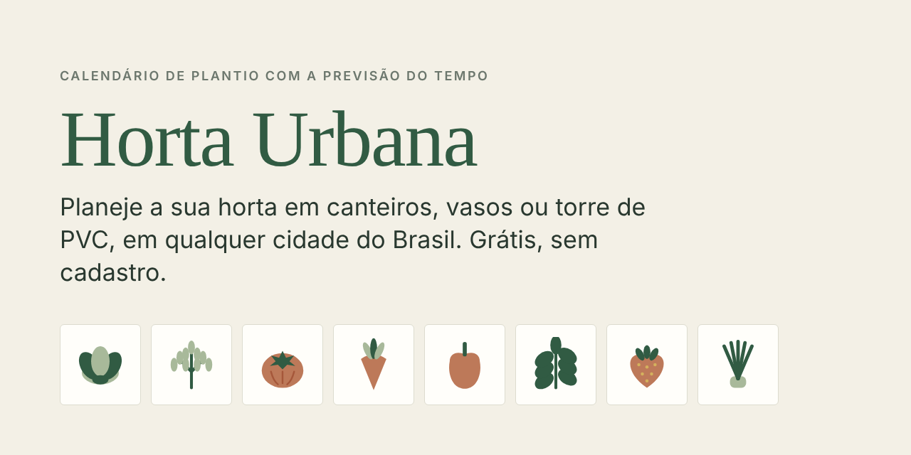
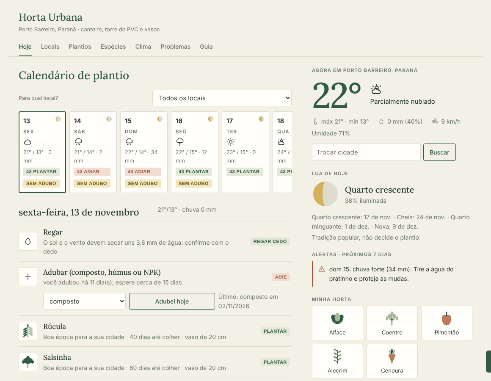
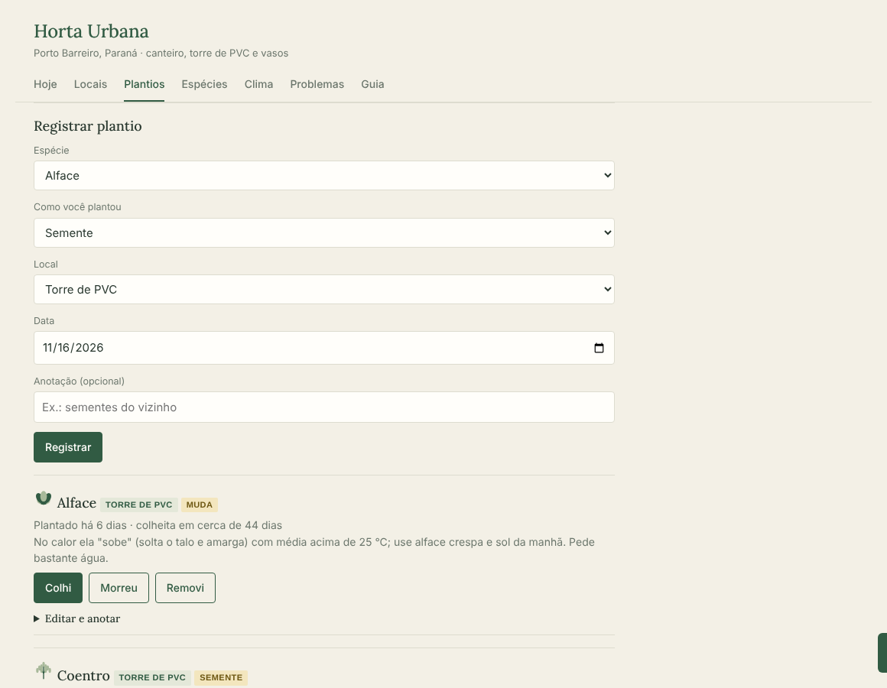
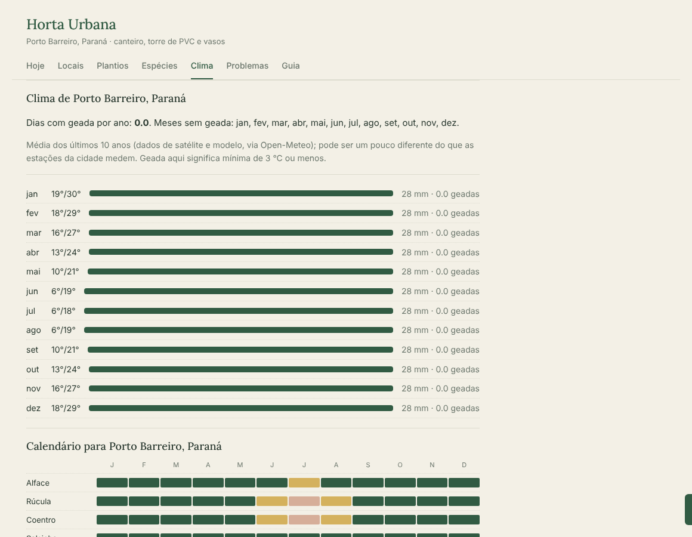
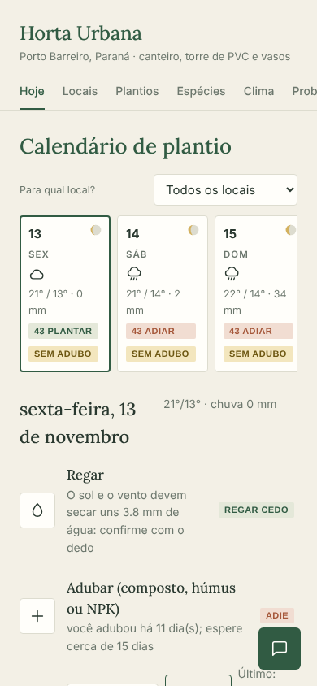

<div align="center">



# 🌱 Horta Urbana

**Calendário de plantio com a previsão do tempo da sua cidade, para hortas em canteiros, vasos e torres de PVC.**

[**▶ Abrir o app**](https://gabriellimasouzza.github.io/horta-urbana/) · [Como usar](#-como-usar) · [Perguntas frequentes](#-perguntas-frequentes)


</div>

---

## O que é

O **Horta Urbana** ajuda quem quer plantar em casa, mesmo em pouco espaço, a saber **o que plantar agora, quando adiar e como cuidar**. Você escolhe a sua cidade e o app usa a previsão e o histórico de clima de lá, junto com recomendações técnicas da Embrapa, para avisar sobre geada, calor, chuva forte e o melhor dia para plantar, adubar e regar.

É gratuito, não pede cadastro e funciona direto no navegador, no computador ou no celular.

<p align="center">
  
</p>

## ✨ O que você faz com ele

| | |
|---|---|
| 📅 **Calendário de 14 dias** | Mostra, dia a dia, se é bom plantar, adubar ou regar, de acordo com geada, calor e chuva previstos. |
| 🪴 **Seus locais** | Cadastre canteiros, vasos e torres de PVC. O app avisa o que não cabe em cada um e calcula água, terra e adubo. |
| 🌱 **Seus plantios** | Registre semente, muda, estaca, bulbilho, rizoma e mais. Veja o prazo de colheita e marque como colhido, morreu ou removido. |
| 🌿 **58 plantas** | Folhas, temperos, plantas para chá, frutos e raízes, com ícone, ciclo, tamanho de vaso e dicas simples. |
| 🌤️ **Clima da sua cidade** | Histórico de 10 anos: dias de geada, meses mais frios e chuvosos, e um calendário anual de plantio. |
| 🌊 **El Niño e La Niña** | Mostra a fase atual e o que ela costuma causar na região da sua cidade, com dicas para a horta. |
| 🐛 **Pragas e doenças** | Sinais e soluções naturais da Embrapa, além de como reconhecer a falta de nutrientes. |
| 💬 **Assistente** | Tire dúvidas rápidas sobre rega, adubo, geada, pragas e cada planta. |

<p align="center">
  
  
</p>

## 🚀 Como usar

1. Abra o **[app](https://gabriellimasouzza.github.io/horta-urbana/)**.
2. Em **Hoje**, digite a sua cidade em "Trocar cidade".
3. Em **Locais**, cadastre onde você planta. Em **Plantios**, registre o que plantou.
4. Volte em **Hoje** para ver o que fazer em cada dia.

Os seus dados ficam **guardados no seu navegador**. Na aba **Guia**, use **Baixar arquivo de backup** de vez em quando, porque limpar os dados do navegador apaga tudo.

<p align="center"></p>

## ❓ Perguntas frequentes

**Funciona na minha cidade?** Sim, em qualquer cidade do Brasil. O app busca a previsão e o histórico de clima do lugar que você digitar.

**Preciso criar conta ou pagar?** Não. É gratuito e não pede cadastro.

**Os meus dados ficam salvos onde?** No navegador do aparelho que você usa. Eles não vão para nenhum servidor meu. Se quiser guardar na nuvem, veja [Para quem quer adaptar](#-para-quem-quer-adaptar).

**De onde vêm as informações de cultivo?** Principalmente de publicações da Embrapa. Veja as [fontes](#-fontes).

**As datas de colheita e os alertas são exatos?** São estimativas para orientar. Alguns limites (como 3 °C para geada) são escolhas minhas e estão marcados na tela. Confira sempre com o pacote de sementes ou com um técnico da sua região.

**Posso usar para outra cidade depois de mudar?** Pode. Troque a cidade e todo o clima, os textos e o calendário passam a usar o novo lugar.

## 🛠️ Para quem quer adaptar

O projeto é **um único arquivo `index.html`**, em HTML, CSS e JavaScript puro, sem instalação nem etapa de build. Para rodar:

```bash
git clone https://github.com/gabriellimasouzza/horta-urbana.git
```

Abra o `index.html` no navegador. Para hospedar a sua versão, ative o GitHub Pages no seu fork.

**Salvar na nuvem (opcional):** há duas formas, descritas na aba **Guia**: login com Google no **Firebase** (veja o [`LEIA-ME-FIREBASE.md`](LEIA-ME-FIREBASE.md)) ou um repositório privado do GitHub com um *Fine-grained token*. O Firebase que está no código é do autor, então, para o seu próprio uso, troque `window.FIREBASE_CONFIG` pelas suas chaves.

**Tecnologias:** [Open-Meteo](https://open-meteo.com/) (previsão, busca de cidades e histórico), índice ONI do NOAA (El Niño), Firebase Authentication e Firestore, API do GitHub.

## ⚠️ Limites conhecidos

- Várias faixas de temperatura e prazos são **estimativas** e estão marcados no app.
- Não há dose de adubo por espécie nem de micronutrientes, porque não achei fonte confiável.
- O calendário da Embrapa por região só está embutido para o Sul; nas outras regiões vale o cálculo pelo clima da cidade.
- Não é instalável como aplicativo nem envia avisos ao celular.

## 📚 Fontes

Publicações da **Embrapa** (*Documentos 161* e *157*, *Catálogo Brasileiro de Hortaliças*, *Horta em Pequenos Espaços*, *Produção de mudas de hortícolas*), **IAPAR**, **MAPA**, **FAO**, **INMET**, **CPTEC/INPE**, **NOAA** e **Simepar**. Os dados de tempo vêm do **Open-Meteo**.

## 🤝 Ajude a melhorar

Achou um erro, tem uma sugestão de planta ou de região? Abra uma [issue](https://github.com/gabriellimasouzza/horta-urbana/issues). Se o app te ajudou, uma ⭐ no repositório também ajuda outras pessoas a encontrá-lo.

## 📄 Licença

Código sob a licença [MIT](LICENSE). As informações de cultivo foram resumidas a partir das fontes acima.

---

<details>
<summary><b>English summary</b></summary>

**Horta Urbana** ("Urban Garden") is a free, single-file web app (Portuguese) for planning a home vegetable and herb garden in beds, pots or PVC towers anywhere in Brazil. It combines a live weather forecast and a 10-year climate history of the chosen city with Embrapa growing guidelines to suggest what to plant, what to postpone (frost, heat, heavy rain) and when to water or fertilize. No account, no install, your data stays in your browser. MIT licensed.

</details>
